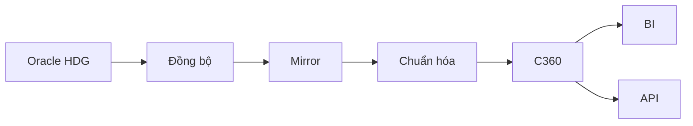
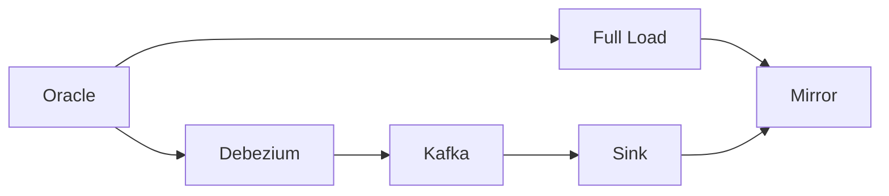
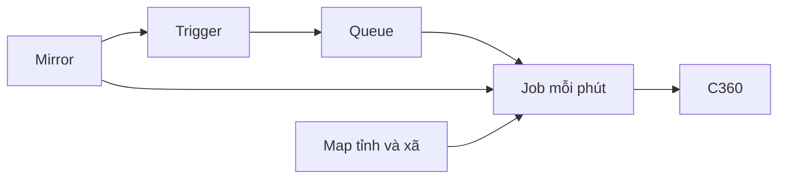

# Tìm hiểu bài toán HDG → C360 → BI & API

Đây là ghi chép giúp tìm hiểu hệ thống, không phải bản thiết kế gửi phê duyệt. Các phương án kỹ thuật được nhắc đến vẫn là đề xuất trong tài liệu thiết kế, chưa mặc định đã được duyệt.

Nội dung dựa trên [yêu cầu gốc](../Yeucau_DataPipeline_HGD_C360_4Tuan.md) và được đối chiếu với hai bản [Basic Design](ThietKeCoBan_BasicDesign_VN_HDG_C360.md), [Detail Design](ThietKeChiTiet_DetailDesign_VN_HDG_C360.md) và hai workbook cùng tên có đuôi .xlsm. Tên bảng trong ghi chép này theo các file thiết kế hiện có.

Các quy tắc được phân biệt thành ba nhóm: **yêu cầu đã quy định**, **cách làm đang đề xuất**, và **điểm chưa rõ cần xác nhận**. Ví dụ dùng người và mã giả lập, chỉ để giải thích cách xử lý.

## Phần 1 — Mục tiêu xây dựng hệ thống

### Dữ liệu đi từ đâu đến đâu?

Bài toán này lấy dữ liệu từ Oracle của hệ thống Hộ gia đình – Nhân khẩu, gọi tắt là HDG. Dữ liệu cho bài tập được sinh giả lập vào Oracle, không lấy trực tiếp từ hệ thống giao dịch thật.

Ở nguồn, một người có thể có nhiều dòng thuộc các hộ khác nhau. Dữ liệu còn có mã địa bàn trước sáp nhập, tên thừa khoảng trắng, ngày sinh chỉ có năm hoặc số định danh chưa đủ. Nếu đưa thẳng các dòng này lên báo cáo, kết quả có thể đếm một người nhiều lần và trả về thông tin chưa có hiệu lực.

Bài toán cần thực hiện hai việc khác nhau:

- **Đồng bộ:** đưa đủ dòng từ Oracle sang nơi xử lý, rồi theo kịp các lần thêm, sửa, xóa.
- **Chuẩn hóa:** từ những dòng đã đồng bộ, lọc theo nghiệp vụ, chọn một dòng đại diện và đưa các trường về cách ghi thống nhất.

### Vì sao cần Mirror rồi mới đến C360?

**Mirror** là các bảng giữ bản sao dữ liệu nguồn. Mục đích là có đủ dữ liệu để xử lý và đối chiếu, không phải bản sao đã lọc. Ví dụ nguồn có hai hộ của cùng một người thì Mirror cũng phải có hai dòng.

**C360** là bảng thông tin công dân sau chuẩn hóa. Trong bài toán này, mỗi MA_CD còn ít nhất một dòng hợp lệ sẽ có một dòng C360. Sử dụng dòng đại diện hợp lệ mới nhất, không lấy tên từ hộ này rồi ghép CCCD của hộ khác.

Tách hai tầng giúp trả lời câu hỏi: “C360 ra kết quả này vì nguồn đã ghi như vậy, hay vì quá trình xử lý bị sai?”. Mirror giữ đầu vào, còn các cột gốc trong C360 giúp xem lại giá trị trước chuẩn hóa của dòng được chọn.

### Kết quả cuối cùng dùng làm gì?

Dữ liệu C360 phục vụ:

1. **Đối soát:** kiểm tra nguồn có sang đủ không, chọn đại diện và chuẩn hóa có đúng không.
2. **BI:** báo cáo bằng bảng và biểu đồ về nhân khẩu, định danh, chất lượng dữ liệu và lịch sử đồng bộ.
3. **REST API:** các địa chỉ HTTP để hệ thống khác tra cứu công dân theo hợp đồng đầu vào/đầu ra rõ ràng.

Kết quả cần đạt không chỉ là có đủ công cụ chạy. Khi thêm, sửa hoặc xóa dữ liệu ở Oracle, Mirror phải cập nhật đúng dòng; C360 phải tính lại đúng người; báo cáo và API phải phản ánh thay đổi. Yêu cầu có job cập nhật mỗi phút và demo đầu ra thay đổi sau khoảng 1–2 phút.

## Phần 2 — Dữ liệu nguồn HDG gồm những gì?

Bốn bảng nằm trong schema VSS. Có thể hiểu schema là nhóm chứa các bảng liên quan trong cơ sở dữ liệu.

### 2.1. VSS.VSS_HO_GD_NHANKHAU — các dòng công dân trong hộ

Bảng có 111 cột. Những cột cần chú ý trước là:

- MA_CD: mã công dân/mã số BHXH, không được NULL.
- MA_HO_GD: mã hộ gia đình, DDL nguồn cho phép NULL.
- HO_TEN, NGAY_SINH, SO_CCCD, SO_CMTND, PHONE_NUMBER: thông tin cá nhân cần chuẩn hóa.
- TYPEID và TRANG_THAI_DUYET: xác định dòng có được tham gia chọn đại diện không.
- MODIFY_DATE, CREATED_DATE và ID: thứ tự chọn dòng đại diện.
- Các nhóm mã tỉnh/xã thường trú, liên hệ và khai sinh.
- DM_DAN_TOC_ID và QUOC_TICH: nối tới danh mục để lấy mã, tên chuẩn.

**NULL** là chưa có giá trị, không tự hiểu là một mã hộ cụ thể. Bảng nguồn chia theo MA_TINH; cách chia vật lý này không thay thế khóa của từng dòng.

Ví dụ có các dòng sau:

| MA_CD | MA_HO_GD | HO_TEN |
|---|---|---|
| 0120456789 | H001 | Nguyễn Văn An |
| 0120456789 | H002 | Nguyễn Văn An |
| 0120456790 | H003 | Trần Thị Bình |

Ở đây có **3 dòng nhân khẩu nhưng chỉ 2 mã công dân khác nhau**. Việc một người có dòng ở nhiều hộ là tình huống được yêu cầu cho sẵn; không cần tự suy ra lý do nghiệp vụ của từng lần xuất hiện.

Khóa logic của một dòng theo yêu cầu là **(MA_CD, MA_HO_GD)**. Khóa là thông tin dùng để phân biệt dòng này với dòng khác. Nếu chỉ dùng MA_CD làm khóa Mirror, lần nạp H002 có thể ghi đè mất H001.

Tuy nhiên, DDL chưa khai báo ràng buộc duy nhất cho cặp này. Cần làm rõ khi hộ NULL hoặc cặp bị trùng thì nhận diện UPDATE/DELETE thế nào. ID là chuỗi và chưa được khai báo khóa chính; không tự coi ID luôn duy nhất.

### 2.2. VSS.VSS_DM_DANTOC — danh mục dân tộc

Bảng có 6 cột, khóa chính là ID. MA và TEN là mã và tên dân tộc; NGAY_HL, NGAY_HET_HL thể hiện thời gian hiệu lực.

Nhân khẩu nối **DM_DAN_TOC_ID → danh mục ID**. Ví dụ nhân khẩu ghi ID=1 thì lấy đúng dòng ID=1. Không nối theo MA rồi chọn tùy ý, vì một mã có thể xuất hiện trong nhiều dòng lịch sử. Việc có cần kiểm ngày hiệu lực tại thời điểm nào vẫn cần xác nhận.

### 2.3. VSS.VSS_DM_QUOC_TICH — danh mục quốc tịch

Bảng có 3 cột: ID, MA, TEN; khóa chính là ID.

Nếu danh mục có ID=233, MA=VN, TEN=Việt Nam, nhân khẩu có thể ghi VN hoặc 233. Cần hỗ trợ cả hai cách ghi. Nếu gặp XX không có trong danh mục, hệ thống giữ giá trị gốc và đánh dấu không tra được, không tự gán Việt Nam.

### 2.4. VSS.VSS_DM_DBHC — danh mục địa bàn

Bảng có 12 cột, không có khóa chính và các cột đều cho phép NULL. Sau sáp nhập, mô hình được mô tả chỉ còn tỉnh và xã:

- Dòng tỉnh: MA_CHA NULL, mã như 01TTT.
- Dòng xã: MA_CHA trỏ tới tỉnh, mã như 00004.
- MA_DBHC_SN: danh sách mã cũ, ví dụ 00013;00004;00019.
- TINH_TRANG và STATUS bằng 1 là các điều kiện đang hoạt động được mô tả.

Mục đích của bảng này là hỗ trợ đổi mã cũ sang mã hiện hành và tìm tỉnh của xã. Có mã xã cũ thuộc nhiều xã mới, nên không phải lần tra nào cũng cho một kết quả.

Việc bảng không có khóa chính còn ảnh hưởng đồng bộ: chưa có căn cứ dùng riêng ID hoặc MA_DBHC để định vị mọi dòng khi sửa/xóa.

## Phần 3 — Quy tắc xử lý dữ liệu

### 3.1. Lọc đúng dòng trước khi chọn đại diện

Yêu cầu loại dòng nếu **TYPEID thuộc GT, GM, GG, GK**, hoặc **TRANG_THAI_DUYET thuộc 1, 3, 4**.

GT là giảm tử; GM là giảm mất tích/đóng mã; GG là giảm gộp; GK là giảm khác. Duyệt 1 là chờ, 3 là từ chối, 4 là hủy. TYPEID NULL không bị loại bởi bộ lọc này; duyệt NULL được xử lý như 0.

Bộ lọc sử dụng đúng danh sách trên. Không tự đổi sang loại mọi mã bắt đầu bằng G, cũng không thêm điều kiện theo IS_ALIVE hay STATUS khi tài liệu chưa quy định.

Ví dụ An có H001 đã duyệt và H002 mới hơn nhưng đang chờ duyệt. H002 được bỏ khỏi tập ứng viên trước, rồi chọn H001. Nếu chọn dòng mới nhất trước khi lọc, An có thể bị loại sai khỏi C360.

### 3.2. Chọn một dòng hợp lệ mới nhất

Trong các dòng còn lại của một MA_CD, thứ tự xét lần lượt là:

1. MODIFY_DATE mới nhất.
2. Nếu bằng nhau, CREATED_DATE mới nhất.
3. Nếu vẫn bằng nhau, ID giảm dần.

Ví dụ H001 sửa lúc 08:00, H002 sửa lúc 09:00 cùng ngày và cả hai hợp lệ, dòng được chọn là H002. CCCD của H002 thiếu thì vẫn xử lý theo H002, không lấy CCCD từ H001 để bù.

Chưa rõ: thời điểm NULL xếp ở đâu, ID dạng chuỗi so sánh thế nào và nếu cả ba tiêu chí bằng nhau thì xử lý ra sao. Detail Design đang minh họa NULLS LAST, nghĩa là xếp giá trị thiếu xuống cuối; đó là lựa chọn thiết kế cần xác nhận, không phải câu đã có trong yêu cầu gốc.

### 3.3. Đổi mã tỉnh/xã theo danh mục sau sáp nhập

**Map** là bảng tra cứu đã chuẩn bị sẵn. Đầu vào là mã đang có trên nhân khẩu; đầu ra là mã hiện hành và trạng thái tra cứu.

Quá trình này gồm hai bước: đưa mã về đúng hình thức, rồi tra danh mục. Chỉ thêm số 0 hoặc bỏ TTT chưa đủ để biết mã đã sáp nhập vào đâu.

Ví dụ:

| Đầu vào | Cách hiểu và kết quả |
|---|---|
| 01TTT, 001, 01 hoặc 1 | Đưa về cách tra thống nhất; nếu là Hà Nội theo danh mục thì tỉnh chuẩn 001 |
| 34TTT, 034 hoặc 34 | Nếu danh mục tỉnh 33TTT có alias 33;34 thì tỉnh chuẩn 033 |
| Xã 13 | Khôi phục dạng 00013, sau đó mới tra mã xã hiện hành |
| 00TTT, 000, 00000 hoặc mã không tồn tại | Không tự tạo tỉnh/xã để điền vào |

Yêu cầu cho ba mức ưu tiên:

- **HIEN_HANH:** mã vẫn đang có hiệu lực thì dùng chính mã đó.
- **SAP_NHAP:** mã cũ chỉ thuộc một đơn vị mới thì đổi sang đơn vị mới.
- **MO_HO:** mã xã cũ thuộc từ hai xã mới trở lên thì xã chuẩn để NULL.

Nếu 00013 chỉ dẫn đến xã 00004, kết quả là 00004. Nếu 00013 dẫn tới hai xã mới, không chọn xã có ID lớn hơn hay chọn dòng đầu tiên. Nếu hai xã cùng thuộc tỉnh 001 thì vẫn giữ được tỉnh 001.

Nếu xã 00004 thuộc tỉnh 001 nhưng nhân khẩu ghi tỉnh 79TTT, yêu cầu là lấy tỉnh theo xã và gắn TINH_LECH_XA. Giá trị tỉnh khai báo vẫn giữ lại ở cột gốc.

Cách này áp dụng riêng cho thường trú, liên hệ và khai sinh. Không dùng kết quả thường trú điền sang hai địa chỉ còn lại.

**Vì sao phải chuẩn bị Map trước?** MA_DBHC_SN chứa nhiều mã trong một chuỗi. Chuỗi được tách thành các mã đơn khi làm mới danh mục; lúc xử lý nhân khẩu chỉ tra bảng phẳng. Tách bằng REGEXP ngay trong mỗi lần nối với bảng nhân khẩu lớn sẽ lặp lại nhiều việc không cần thiết và trái yêu cầu.

Khi làm mới Map, yêu cầu là DELETE rồi INSERT trong cùng **transaction**, tức một nhóm thay đổi được xác nhận hoặc hủy cùng nhau. Như vậy người đọc không thấy khoảng giữa “đã xóa Map cũ nhưng chưa thêm Map mới”. Không dùng TRUNCATE cho thao tác làm mới Map.

Còn cần chốt: ngày hiệu lực của danh mục được xét thế nào, mã hiện hành bị trùng thì sao, xã mơ hồ thuộc nhiều tỉnh xử lý ra sao, và có cần ghép lại chuỗi địa chỉ bằng tên tỉnh/xã mới không.

### 3.4. Họ tên, ngày sinh, số định danh và điện thoại

**Họ tên:** bỏ khoảng trắng đầu/cuối và thu gọn khoảng trắng ở giữa. “  Nguyễn   Văn  An ” thành “Nguyễn Văn An”. Tên không dấu viết hoa là “NGUYEN VAN AN”, dùng để tìm kiếm. Không tự đổi chính tả tên người.

**Ngày sinh:** giữ đúng mức thông tin nguồn có, không tự thêm ngày/tháng.

| Giá trị nguồn | Chuỗi chuẩn cần hiểu |
|---|---|
| 19950815 | 19950815 nếu ngày hợp lệ |
| 19950000 hoặc 1995 | 1995 |
| 19950800 hoặc 199508 | 199508 |
| 19950230 | NULL vì không có ngày 30/02 |
| 17500101 | Được yêu cầu đưa vào nhóm ví dụ năm không hợp lý; khoảng năm cụ thể còn phải chốt |

Trong thiết kế hiện có, tên cột kết quả là NGAY_SINH_CHUAN. NGAY_SINH_GOC giữ đầu vào. Không đổi 1995 thành 19950101, vì như vậy sẽ tạo ra thông tin nguồn không có.

**Số định danh:** xét SO_CCCD trước. Nếu không có chuỗi hợp lệ đủ 12 chữ số thì xét SO_CMTND. Nếu chỉ có CMND 9 số, kết quả định danh 12 số vẫn thiếu; không thêm số 0 cho đủ. Một chuỗi đủ 12 số cũng chưa chứng minh đó là giấy tờ đã xác thực.

**Điện thoại:** yêu cầu đầu ra bắt đầu bằng 0 và dài 10 hoặc 11 số. Cách chuyển các dạng đầu vào cần được thống nhất. Với các ví dụ đã cho, phương án đang phân tích là:

- 0912345678 giữ nguyên.
- 84912345678 và 840912345678 chuyển về 0912345678.
- 912345678 thêm số 0 đầu; 0912 345 678 bỏ khoảng trắng.
- 12345 không hợp lệ, không đoán thêm số để sửa.

Đây là ví dụ cách chuẩn hóa, không phải căn cứ tự xóa mọi dấu câu hoặc áp danh sách đầu số nhà mạng. Khoảng năm sinh hợp lý, ngày tương lai, trường bị thiếu và các dạng điện thoại ngoài ví dụ vẫn cần xác nhận.

### 3.5. Dân tộc và quốc tịch

Mã/tên dân tộc được lấy bằng DM_DAN_TOC_ID nối vào ID danh mục. Với quốc tịch, cần phân biệt chuỗi mã như VN và ID dạng chuỗi như 233 rồi tra đúng cột.

Nếu không tra được thì không tự dùng giá trị mặc định. Nếu một mã tra ra nhiều dòng thì cũng không tự chọn dòng đầu. Cần làm rõ quy tắc hiệu lực hoặc tính duy nhất trước.

### 3.6. DQ_FLAGS cho biết trường nào có vấn đề

DQ_FLAGS là cột ghi các mã lỗi chất lượng, ngăn cách bằng dấu chấm phẩy. Mục đích là **giữ lại công dân hợp lệ nghiệp vụ, đồng thời chỉ ra thông tin nào chưa dùng được**.

Ví dụ An còn hiệu lực nhưng ngày sinh sai và thiếu định danh 12 số. C360 vẫn có An; ngày sinh chuẩn NULL; cờ gồm NGAY_SINH_LOI;KHONG_SO_DINH_DANH. Sửa ngày sinh đúng thì tính lại cờ, bỏ lỗi ngày sinh và giữ lỗi định danh nếu chưa sửa.

Các cờ yêu cầu nêu gồm TINH_KHONG_MAP, XA_KHONG_MAP, XA_MO_HO, TINH_LECH_XA, NGAY_SINH_LOI, SDT_LOI, KHONG_SO_DINH_DANH. Tên cờ dân tộc/quốc tịch và cách phân biệt lỗi ở ba nhóm địa chỉ cần thống nhất thêm.

Những việc không được tự thực hiện: ghép nhiều hộ để bù thông tin, chọn một xã mơ hồ, đặt quốc tịch mặc định, thêm ngày sinh hoặc đoán số điện thoại. Khác với lỗi ở một trường, lỗi khóa khiến không định vị được dòng đồng bộ phải được xử lý riêng; không chỉ gắn DQ rồi bỏ qua sự kiện.

## Phần 4 — Luồng đồng bộ dữ liệu

Luồng đồng bộ gồm tám bước. Ở mỗi bước, cần nhìn đầu vào, việc xử lý, đầu ra và điều gì xảy ra nếu bước đó dừng.

### 4.1. Sinh dữ liệu giả lập tại Oracle

**Thành phần này là gì?** Bộ sinh dữ liệu tạo danh mục và các dòng nhân khẩu giả để kiểm tra hệ thống.

**Vào → xử lý → ra:** từ tham số số người và các tình huống cần kiểm tra, sinh ba danh mục rồi sinh nhân khẩu vào Oracle. Yêu cầu đưa ví dụ 50.000–200.000 người, có người nhiều hộ, khoảng 2–3% dòng thuộc nhóm bị lọc, cùng các trường hợp cần chuẩn hóa.

Cần thêm bộ tạo thay đổi sau đó: thêm người/hộ, sửa CCCD hoặc ngày sinh, đổi duyệt, đổi MA_CD và xóa. Cách sinh nên tái hiện được để xác định kết quả mong đợi, không chỉ sinh ngẫu nhiên rồi nhìn đầu ra.

**Nếu lỗi:** dữ liệu đầu vào có thể chưa đủ hoặc chưa có tình huống cần kiểm. Cần xác định phần nào đã ghi thành công trước khi chạy lại, tránh vô tình sinh trùng.

### 4.2. Full Load nạp ban đầu sang Mirror

**Full Load** là nạp toàn bộ dữ liệu cần đồng bộ tại một mốc. Mục đích là tạo nền ban đầu đủ bốn bảng, vì luồng chỉ đọc thay đổi không tự chứa mọi dòng đã tồn tại từ trước.

**Vào → xử lý → ra:** đọc bốn bảng Oracle theo từng lô, giữ kiểu và giá trị gốc, ghi sang Mirror. Nhân khẩu vào MIRROR_HDG_NHANKHAU; ba danh mục vào các bảng MIRROR_DM_* theo thiết kế.

**Snapshot** là ảnh dữ liệu nhìn tại một mốc nhất quán. Ví dụ đọc nửa bảng trước khi An đổi hộ và nửa còn lại sau khi đổi thì có thể tạo một tập không phản ánh đúng thời điểm nào. Vì vậy cần chốt cách đọc snapshot hoặc tạm dừng ghi trong lúc nạp ban đầu.

Yêu cầu có đọc JDBC trên MA_CD dạng chuỗi. JDBC là giao diện để công cụ Java như Spark đọc DB. Không chia khoảng số trực tiếp trên cột mã chuỗi; cần điều kiện chia miền hoặc cách chia theo giá trị băm đã kiểm không bỏ sót/trùng dòng. Đọc song song quá nhiều cũng có thể làm nguồn quá tải.

Oracle NUMBER không khai báo độ chính xác cần cách chuyển kiểu không làm tròn mất số. Oracle DATE có phần giờ; VARCHAR2 BYTE giới hạn theo byte, không giống hoàn toàn giới hạn theo số ký tự. Không tự ép mọi NUMBER sang số thực hoặc cắt chuỗi để nạp cho xong.

**Nếu lỗi:** Mirror có thể mới nhận một phần dữ liệu. Phương án đang đề xuất là ghi tiến độ và nạp qua vùng tạm để kiểm trước khi công bố. Chạy lại phải không nhân đôi và không đưa dữ liệu cũ đè lên thay đổi mới đã tới.

### 4.3. CDC đưa thay đổi qua Kafka

**CDC** là cơ chế thu các thay đổi sau khi dữ liệu được thêm, sửa hoặc xóa. Cơ chế này tránh phải Full Load lại toàn bộ bảng mỗi lần An sửa tên.

**Debezium** là thành phần đọc thay đổi từ nhật ký Oracle. Nhật ký này ghi những gì đã thay đổi trong DB; phương án thiết kế dùng cơ chế LogMiner để đọc.

**Kafka** là nơi lưu luồng sự kiện theo thứ tự trong từng phần của luồng. Nó giữ sự kiện để bên ghi đích có thể đọc theo tốc độ riêng và đọc lại khi cần. Kafka không tự chọn đại diện hay chuẩn hóa tên.

**Vào → xử lý → ra:** thay đổi đã commit ở Oracle → sự kiện có loại thao tác, khóa và nội dung liên quan → Kafka. Commit nghĩa là giao dịch đã được xác nhận; không nên làm đích phản ánh thay đổi nguồn đã bị hủy.

**Nếu lỗi:** Oracle có thể đã thay đổi nhưng sự kiện chưa tới đích. Cần giữ vị trí đọc và nhật ký đủ lâu để tiếp tục. Không xóa vị trí đọc hoặc bỏ sự kiện lỗi chỉ để thấy luồng chạy lại.

Mốc nối giữa Full Load và CDC rất quan trọng: nếu nạp ban đầu kết thúc ở mốc A, nhưng CDC bắt đầu sau mốc B, thay đổi giữa A và B có thể mất. SCN là mốc thay đổi của Oracle; offset là vị trí đã đọc trong luồng. Thiết kế cần xác định các mốc này, hoặc chọn cách tạm dừng ghi đã được cho phép, rồi mới mở lại nguồn.

### 4.4. Sink cập nhật Mirror

**Sink** là thành phần đọc sự kiện Kafka và ghi vào database đích. Trong thiết kế, Sink xử lý thêm/cập nhật theo khóa dòng và xóa khi nhận sự kiện xóa.

**Upsert** nghĩa là có dòng theo khóa thì cập nhật, chưa có thì thêm. Mục đích là áp lại sự kiện mà không tạo thêm dòng trùng. **Idempotent** nghĩa là chạy lại cùng việc vẫn cho trạng thái đúng, không làm dữ liệu tăng thêm hoặc lệch đi chỉ vì chạy lại.

**Vào → xử lý → ra:** sự kiện Kafka → xác định đúng dòng công dân–hộ → Mirror cập nhật. Không dùng riêng MA_CD để ghi đè vì một người có nhiều hộ.

**Nếu lỗi:** sự kiện có thể còn ở Kafka trong khi Mirror vẫn cũ. Đó là xử lý chậm, chưa phải bằng chứng mất dữ liệu. Tuy nhiên, nếu khóa sai thì có thể cập nhật/xóa nhầm hộ, nên xác minh khóa phải làm trước.

### 4.5. Mirror ghi mã thay đổi vào Queue

**Queue** là bảng hàng đợi chứa MA_CD cần tính lại. Không cần mang toàn bộ nội dung dòng vào Queue, vì job sẽ đọc trạng thái hiện tại từ Mirror.

**Trigger** là xử lý được DB gọi khi dòng Mirror thay đổi. Yêu cầu trigger nhẹ, chỉ thêm khóa vào Queue:

- Thêm dòng: ghi mã mới.
- Xóa dòng: ghi mã cũ.
- Sửa dòng: ghi mã liên quan; nếu đổi MA_CD thì ghi cả mã cũ và mới.

**Vào → xử lý → ra:** một thay đổi Mirror → một hoặc hai mã bị ảnh hưởng → C360_CHANGE_QUEUE. Mirror và Queue nên cùng transaction: Mirror ghi thất bại thì không để lại một thông báo thay đổi không có thật.

**Nếu lỗi:** C360 có thể không biết phải tính lại ai. Không được coi Sink đã ghi thành công nhưng trigger thất bại là một cập nhật hoàn chỉnh; cần xử lý giao dịch và lỗi rõ ràng.

### 4.6. Job chuẩn hóa cập nhật C360

Job là tác vụ chạy tự động. Yêu cầu tác vụ chạy mỗi phút; cách gọi Near Real-time ở đây có nghĩa là cập nhật gần thời gian thực theo lô, không phải mọi API đọc đều truy cập Oracle tức thời.

**Vào → xử lý → ra:** lấy một lô Queue → gom các MA_CD khác nhau → đọc toàn bộ dòng Mirror cho từng mã → lọc, chọn đại diện, chuẩn hóa → cập nhật C360. Không còn dòng hợp lệ thì xóa mã đó khỏi C360.

MERGE là thao tác hợp nhất thêm/cập nhật theo khóa; PostgreSQL có thể dùng cách upsert tương ứng. Full Load C360 và job từng phút phải dùng chung một logic chuẩn hóa để không ra hai kết quả khác nhau.

Sau khi xử lý thành công, job **ACK** Queue, tức xác nhận/xóa đúng các dòng hàng đợi đã xử lý. Việc cập nhật C360 và ACK phải được xác nhận cùng transaction. Nếu C360 chưa ghi xong mà Queue đã bị xóa, lần chạy sau không biết cần làm lại.

**Nếu lỗi:** rollback, nghĩa là hủy phần thay đổi của giao dịch lỗi, và giữ Queue để thử lại. Không báo thành công chỉ vì job đã đọc được khóa.

### 4.7. Đối soát giữa các tầng

**Vào → xử lý → ra:** lấy số dòng, tập mã và mẫu dữ liệu ở nguồn, Mirror, C360 tại các mốc có thể so được → so với quy tắc → ghi kết quả khớp hoặc lệch.

Bước này giúp phát hiện hai loại lỗi khác nhau: truyền thiếu dòng và chuẩn hóa sai. Nếu CDC chưa bắt kịp, cần ghi nhận đang trễ hoặc chờ xử lý xong, không kết luận ngay là mất dữ liệu.

**Nếu lỗi:** pipeline vẫn có thể đang cập nhật nhưng chưa có bằng chứng để xác định dữ liệu đúng hay sai. Không đổi trạng thái đối soát thành “khớp” khi câu truy vấn bị timeout. Ví dụ kiểm tra cụ thể ở Phần 8.

### 4.8. BI và API đọc C360

**Vào → xử lý → ra:** công dân đã chuẩn hóa → tính chỉ tiêu BI hoặc tra theo yêu cầu API → biểu đồ/kết quả trả về.

BI có ba nhóm: nhân khẩu và định danh; chất lượng dữ liệu; lịch sử đồng bộ. Đếm công dân ở C360, không lấy số dòng hộ ở Mirror làm dân số. Nếu một người có nhiều cờ lỗi, không cộng các tỷ lệ lỗi rồi coi đó là tỷ lệ người có lỗi.

Bốn API cần hiểu đúng:

1. GET /api/v1/ca-nhan/{ma}: tìm mã hiện hành, rồi mã cũ, rồi định danh 12 số; dừng tầng đầu có kết quả. Không thấy trả 404; mã cũ/định danh khớp nhiều người trả 409 và các ứng viên.
2. POST /api/v1/ca-nhan/tra-cuu-lo: tối đa 1.000 mã, trả kết quả từng mã.
3. GET /api/v1/ca-nhan/tim-kiem: tìm bằng tên dấu/không dấu và ngày sinh năm/tháng/ngày; phải hỗ trợ ngày sinh lưu rút gọn.
4. GET /api/v1/ca-nhan/thay-doi: trả trang tiếp theo bằng cursor, tức con trỏ dựa trên cặp SYNC_DATE và ID, cùng độ trễ an toàn.

API dùng X-API-Key; DB chỉ lưu giá trị băm SHA-256 của key và kiểm scope, tức quyền được gọi từng nhóm API. Audit là nhật ký tra cứu, được ghi bất đồng bộ theo lô thay vì chờ từng lần ghi log hoàn tất.

**Nếu lỗi:** API trả lỗi phù hợp thay vì giả kết quả không tồn tại; BI cần cho biết dữ liệu đang ở mốc nào. Nếu Oracle vừa đổi nhưng CDC đang trễ thì API vẫn có thể đọc trạng thái C360 cũ. Đó là khác biệt cần hiểu giữa đọc C360 và đọc trực tiếp nguồn.

## Phần 5 — Kiến trúc tổng thể

### 5.1. Nhìn toàn bộ luồng



Dữ liệu bắt đầu ở Oracle, được đồng bộ đủ dòng sang Mirror, rồi mới lọc và chuẩn hóa thành C360. BI và API đọc kết quả C360. Nếu kết quả tra cứu sai, có thể lần ngược từ C360 về Mirror rồi về nguồn để tìm chỗ phát sinh sai khác.

### 5.2. Nạp ban đầu và theo dõi thay đổi



Nhánh Full Load đọc toàn bộ tại một mốc để tạo dữ liệu nền. Nhánh Debezium → Kafka → Sink mang các lần thêm, sửa, xóa sau đó sang Mirror. Hai nhánh cần bàn giao theo mốc rõ ràng; không phải cứ bật cả hai là tự hết mất/trùng dữ liệu.

### 5.3. Từ thay đổi Mirror đến một dòng C360



Mirror đổi thì trigger ghi mã vào Queue. Job đọc danh sách mã cần xử lý, nhưng lấy nội dung hiện tại từ Mirror và tra địa bàn qua Map. Job tính lại một dòng C360 hoặc xóa mã không còn dòng hợp lệ. Queue là thông báo cần làm việc, không phải nguồn dữ liệu thay thế Mirror.

## Phần 6 — Các bảng đích và bảng phụ trợ dùng để làm gì?

### 6.1. Mirror: giữ đủ đầu vào

MIRROR_HDG_NHANKHAU giữ từng dòng nhân khẩu; MIRROR_DM_* giữ ba danh mục. Giá trị gốc không bị sửa thành mã chuẩn ở đây.

Ví dụ Oracle có An/H001 và An/H002 thì Mirror cũng có hai dòng. Nếu H002 chưa duyệt, Mirror vẫn giữ H002; bộ lọc chỉ tác động tới C360.

### 6.2. C360: thông tin công dân để khai thác

C360_THONG_TIN_CA_NHAN giữ một dòng cho mỗi mã còn hợp lệ. Trong thiết kế, MA_CD ánh xạ thành MA_SO_BHXH; tên chuẩn là HO_TEN; ngày sinh chuẩn là NGAY_SINH_CHUAN; số định danh là SO_DINH_DANH.

Ví dụ dòng đại diện của An có NGAY_SINH=19950000 thì C360 lưu NGAY_SINH_CHUAN=1995 và giữ NGAY_SINH_GOC=19950000. Việc lấy MA_SO_BHXH_CU từ MA_CD_OLD hay lưu thêm toàn lịch sử cần xác nhận, không tự ghép từ mọi hộ.

### 6.3. Map tỉnh/xã: tránh tra lại chuỗi mã cũ

C360_MAP_DBHC_TINH và C360_MAP_DBHC_XA lưu kết quả tra từ mã đã chuẩn hóa hình thức tới đơn vị hiện hành, kèm trạng thái tra cứu.

Ví dụ Map xã có đầu vào 00013, đầu ra 00004, trạng thái SAP_NHAP. Nếu có hai ứng viên thì dòng Map cần thể hiện MO_HO thay vì chọn một xã để vừa ràng buộc khóa.

### 6.4. Queue: nhớ mã nào cần tính lại

C360_CHANGE_QUEUE có ID cho từng lần ghi nhận và MA_CD bị ảnh hưởng. Một mã có thể có nhiều dòng Queue.

Ví dụ hai hộ của An cùng thay đổi thì có thể ghi hai dòng cho mã An. Job có thể tính An một lần trong lô, nhưng phải xác định chính xác những ID đã nhận và được phép xóa.

### 6.5. Sync Control: phối hợp Full Load và job từng phút

C360_SYNC_CONTROL lưu trạng thái điều khiển. Thiết kế đề xuất CONTROL_KEY để xác định nhóm job và FULL_RUNNING để báo đang nạp lại toàn bộ C360.

Ví dụ job từng phút đang cập nhật An thì Full Load C360 không được xóa/nạp lại bảng ngay. Hai bên khóa cùng dòng control, đợi nhau theo quy tắc đã thống nhất. Cờ FULL_RUNNING riêng lẻ mà không có khóa không đủ ngăn hai bên chạy chồng.

### 6.6. Sync Log: biết mỗi lô đã làm gì

C360_SYNC_LOG lưu lần chạy, thời gian, số mã, số thêm/cập nhật/xóa và lỗi.

Ví dụ một lô xử lý 100 mã, cập nhật 95 và xóa 5. Log giúp giải thích kết quả và phát hiện lô bị lỗi; không dùng “job đã chạy” thay cho “dữ liệu đã đúng”.

### 6.7. Bảng đối soát: lưu bằng chứng chênh lệch

C360_RECON_RESULT lưu kết quả kiểm tra giữa các tầng, theo bảng/tỉnh hoặc chỉ tiêu cần so.

Ví dụ tại mốc đã chốt, nguồn có 1.000 dòng, Mirror có 998 thì ghi lệch 2 và thông tin lần kiểm. Nếu nguồn đang đổi và CDC chưa xử lý hết, cần ghi rõ điều kiện đó trước khi quy lỗi mất dòng.

### 6.8. Audit Log: ai đã tra cứu gì?

C360_API_AUDIT lưu client, thao tác, kết quả và thông tin theo dõi cần thiết. Client là bên gọi API.

Ví dụ client X gọi tra cứu mã An và nhận 200; audit ghi lần gọi/kết quả nhưng không cần sao chép toàn bộ hồ sơ hoặc API key gốc. Thời gian giữ log, mức che thông tin và cách xử lý khi không ghi được audit vẫn cần thống nhất.

## Phần 7 — Theo dõi một công dân khi dữ liệu thay đổi

Ví dụ xuyên suốt sử dụng công dân An: MA_CD ban đầu là **0120456789**, gọi ngắn là **A**; mã mới **0120456799**, gọi là **B**. An xuất hiện ở H001 và sau đó H002.

Các kết quả bên dưới là trạng thái **sau khi luồng đồng bộ và chuẩn hóa đã xử lý xong**. Trong lúc luồng đang chạy, các tầng có thể chưa đổi cùng một lúc.

### 7.1. Thêm An vào nguồn

Oracle thêm A/H001, tên “  Nguyễn   Văn  An ”, duyệt 2, TYPEID NULL, ngày sinh 19950000, chưa có CCCD.

Mirror thêm nguyên dòng A/H001. Trigger ghi A vào Queue. C360 tạo một dòng A, tên “Nguyễn Văn An”, ngày sinh chuẩn 1995; thiếu định danh 12 số thì có KHONG_SO_DINH_DANH. Không tự đặt ngày 01/01.

### 7.2. An được sửa tên hoặc bổ sung CCCD

Oracle cập nhật đúng A/H001, chẳng hạn tên thành “Nguyễn Văn An Minh”, SO_CCCD=001095012345 và MODIFY_DATE mới hơn.

Mirror cập nhật dòng đó. C360 tính lại A từ dòng hiện tại, có tên mới và định danh đủ 12 số; lỗi thiếu định danh được gỡ. Gỡ lỗi này không có nghĩa mọi trường khác đều đã hợp lệ.

### 7.3. An xuất hiện thêm ở hộ H002

Theo kịch bản yêu cầu, Oracle thêm A/H002 với thời điểm sửa mới hơn H001; H001 vẫn còn. Không mặc định chuyển hộ đồng nghĩa với xóa hộ cũ.

Mirror lúc này có hai dòng của A. Nếu H002 hợp lệ thì C360 vẫn chỉ một dòng A, lấy nguyên H002. Nếu CCCD ở H002 thiếu thì kết quả thiếu theo H002, không lấy CCCD H001 để bù.

### 7.4. Dòng H002 không còn hợp lệ

Oracle đổi TYPEID của A/H002 thành GG, hoặc đổi duyệt sang 4. Mirror giữ dòng đó và cập nhật trạng thái, không xóa dòng thô chỉ vì bị lọc.

H001 còn hợp lệ nên C360 chuyển đại diện về H001. Nếu không còn bất kỳ dòng hợp lệ nào của A thì mới xóa A khỏi C360.

Nếu đổi duyệt của H002 từ 1 sang 2, dòng có thể lại tham gia chọn đại diện. C360 phải tính lại chứ không chỉ thêm một cờ.

### 7.5. Xóa dòng hộ mới nhất

Để kiểm tình huống này, H002 được chuyển về trạng thái hợp lệ và là dòng mới nhất, rồi DELETE A/H002 ở Oracle.

Mirror xóa đúng A/H002; H001 vẫn còn. Queue nhận A. C360 quay về H001. Nếu tiếp tục xóa cả H001, C360 không còn A sau khi xử lý xong.

### 7.6. Đổi MA_CD sang mã mới

Tiếp từ tình huống còn H001, Oracle đổi A/H001 thành B/H001 và ghi MA_CD_OLD=A. Mirror phải bỏ khóa dòng cũ và có dòng theo khóa mới; Queue nhận cả A lẫn B.

Vì ví dụ này không còn dòng nào của A, C360 xóa A và tạo B nếu B có dòng hợp lệ. Nếu B đã có các hộ khác thì phải gom toàn bộ dòng của B và chọn lại đại diện, không mặc định H001 luôn thắng.

Nếu đổi mã lúc A còn một hộ hợp lệ khác, C360 chưa được xóa A. Khi đó tính lại cả A và B theo trạng thái hiện tại. Cách chuyển mã toàn công dân hay chỉ một dòng hộ cần làm rõ trước khi kết luận “đổi mã là xóa sạch mã cũ”.

### 7.7. Mất kết nối hoặc CDC xử lý chậm

An sửa thông tin và đã commit ở Oracle, nhưng Debezium mất kết nối: Oracle đã mới, Mirror/C360 có thể vẫn cũ.

Nếu sự kiện đã tới Kafka nhưng Sink chậm, Kafka giữ phần chưa xử lý; Mirror vẫn chậm hơn nguồn. Nếu Mirror đã mới nhưng job C360 lỗi, Queue cần còn lại để lần sau làm tiếp.

Cần giữ các vị trí đọc và nhật ký/sự kiện đủ lâu để tiếp tục sau khi kết nối phục hồi. Sự kiện được đọc lại phải không tạo trùng dòng. Nếu dữ liệu nhật ký cần đọc đã hết thời gian lưu, không thể tự tuyên bố tiếp tục không mất thay đổi; phải chọn cách nạp lại và đối soát.

## Phần 8 — Đối soát và cách kiểm chứng

### 8.1. Nguồn có sang đủ Mirror không?

Đầu tiên, so sánh tổng dòng và số dòng theo MA_TINH. Mã tỉnh ở đây là giá trị thô của nguồn/Mirror, không so trực tiếp với mã đã sáp nhập ở C360.

Các câu dưới chỉ là **SQL minh họa để đọc hiểu**, không phải bộ SQL triển khai đã được chốt hoặc chạy thử.

```sql
-- Oracle nguồn
SELECT MA_TINH, COUNT(*) AS SO_DONG
FROM VSS.VSS_HO_GD_NHANKHAU
GROUP BY MA_TINH;

-- Database đích
SELECT MA_TINH, COUNT(*) AS SO_DONG
FROM MIRROR_HDG_NHANKHAU
GROUP BY MA_TINH;
```

Hai kết quả phải được lấy ở mốc có thể so sánh: tạm ổn định nguồn hoặc biết luồng đã bắt kịp điểm cần kiểm. Nếu An vừa được thêm trong lúc đang đếm, lệch một dòng chưa đủ kết luận pipeline làm mất dữ liệu.

Count bằng nhau cũng chưa chứng minh nội dung đúng. Cần kiểm tra thêm khóa, các dòng mẫu trước/sau và những người có nhiều hộ.

### 8.2. Mirror và C360 có cùng số công dân hợp lệ không?

```sql
-- PostgreSQL minh họa: lọc trước rồi đếm mã khác nhau
SELECT COUNT(DISTINCT MA_CD) AS SO_CONG_DAN_HOP_LE
FROM MIRROR_HDG_NHANKHAU
WHERE COALESCE(TYPEID, 'ZZ') NOT IN ('GT', 'GM', 'GG', 'GK')
  AND COALESCE(TRANG_THAI_DUYET, 0) NOT IN (1, 3, 4);

SELECT COUNT(*) AS SO_CONG_DAN_C360
FROM C360_THONG_TIN_CA_NHAN;
```

COALESCE lấy giá trị thay thế khi cột NULL; ở đây duyệt NULL thành 0, tương đương cách NVL trong yêu cầu Oracle.

Hai số phải khớp sau khi xử lý xong cùng phạm vi thay đổi. Cần so sánh thêm tập mã, vì thiếu An nhưng thừa một người khác vẫn có thể cho hai count bằng nhau.

### 8.3. Trường chuẩn hóa có đúng không?

Sử dụng những đầu vào đã biết trước kết quả: 19950800 → 199508; tên thừa khoảng trắng → tên gọn; xã 00013 → 00004 khi Map duy nhất; xã mơ hồ → NULL và XA_MO_HO.

Với An, cần xem đầy đủ các dòng Mirror để biết dòng nào phải thắng, rồi đối chiếu C360 và cột gốc. Không dùng chính hàm chuẩn hóa để tạo cả kết quả thực tế lẫn kết quả mong đợi, vì cùng một lỗi có thể xuất hiện ở cả hai.

### 8.4. Cần kiểm tra gì sau thêm/sửa/xóa?

Mỗi lần kiểm ghi lại đầu vào nguồn, thời điểm commit, kết quả Mirror, C360 và Queue/log tương ứng.

- INSERT: dòng mới tới Mirror; C360 thêm người hoặc chọn lại đại diện.
- UPDATE: đúng dòng hộ đổi, C360 tính lại và gỡ/thêm cờ phù hợp.
- DELETE: đúng dòng biến mất; C360 lùi về hộ khác hoặc xóa người.
- Đổi mã: kiểm cả mã cũ và mới, gồm trường hợp mã cũ còn hộ hợp lệ.

Để kiểm mục tiêu 1–2 phút, cần theo dõi cả thời điểm nguồn, Mirror, C360, BI và API; không chỉ đo thời gian một job chạy.

### 8.5. Chạy lại có làm trùng hoặc mất dữ liệu không?

Chạy lại Full Load ở cùng mốc đầu vào rồi kiểm tra count, khóa và nội dung nghiệp vụ. Với sự kiện CDC đọc lại, Mirror không được mọc thêm một hộ trùng. Job C360 chạy lại cùng đầu vào vẫn phải chọn cùng đại diện theo quy tắc đã chốt.

Nếu nguồn đang đổi thì kết quả trước/sau có thể khác hợp lệ; không đòi mọi trường thời gian/log bất biến. Quan trọng là chạy lại không tạo sai dữ liệu hoặc bỏ qua phần chưa làm.

### 8.6. Kiểm hai việc chạy cùng lúc

**Thứ tự ID Queue không phải thứ tự commit.** T1 được ID=100 nhưng chưa commit; T2 được ID=101 và commit trước. Job nhìn thấy 101, xử lý và xóa đúng 101. Khi T1 commit, 100 phải còn để lượt sau xử lý.

Nếu job lưu “đã xử lý đến 101” rồi chỉ đọc ID lớn hơn 101, nó sẽ bỏ sót 100. Vì vậy cần kiểm tra cách nhận/xóa chính xác tập ID nhìn thấy, không chỉ kiểm kết quả khi mọi giao dịch chạy nối đuôi.

**Full Load C360 và job từng phút:** Full Load cần đặt trạng thái tạm dừng, dùng khóa Sync Control và đợi lô đang chạy xong rồi mới TRUNCATE, tức xóa nhanh dữ liệu bảng để nạp lại. Đừng nhầm với Map, nơi yêu cầu không được dùng TRUNCATE.

Full Load phải đọc Mirror, Map và các Queue rows liên quan trong snapshot nhất quán. Chỉ xóa Queue IDs mà lần nạp đã bao phủ; sự kiện commit sau snapshot phải còn. Nếu nạp lỗi, cần khôi phục trạng thái trước và không mở lại job khi chưa biết giao dịch đã commit hay chưa.

Với Map, cần kiểm tra người đọc không thấy bảng rỗng giữa xóa/thêm và không trộn hai phiên bản tỉnh/xã. Khi danh mục đổi mà dòng nhân khẩu không đổi, cần xác nhận cách tính lại công dân bị ảnh hưởng, nếu không C360 có thể giữ mã hoặc cờ cũ.

## Phần 9 — Công nghệ sử dụng

### Oracle

Oracle lưu bốn bảng nguồn và nhật ký thay đổi. Mục đích là giả lập đủ gần bài toán nguồn thật để kiểm cả nạp ban đầu lẫn CDC. Quyền đọc nhật ký và thông tin khóa trước/sau thay đổi phải được kiểm, không chỉ kiểm kết nối SELECT thành công.

### Python hoặc Spark

Python phù hợp viết bộ sinh dữ liệu, tác vụ đọc theo lô và đối soát. Spark là công cụ xử lý dữ liệu song song, có thể đọc Oracle qua JDBC khi cần chia việc đọc.

Yêu cầu nhắc việc đọc JDBC và tránh cache/repartition gây hết bộ nhớ hoặc tạo dữ liệu trung gian quá lớn. Nếu dùng Python driver thay JDBC thì phải xác nhận lựa chọn đó, không gọi mọi cách đọc Oracle là JDBC. Python Full Load trong sơ đồ tổng quan và JDBC trong phần chi tiết thiết kế hiện còn cần thống nhất.

### Debezium và Kafka

Debezium đọc nhật ký để tạo sự kiện thay đổi. Kafka giữ và chuyển các sự kiện cho Sink. Tách hai việc này giúp nguồn tiếp tục ghi trong khi đích đọc chậm hơn, miễn là thời gian lưu sự kiện còn đủ.

Đây là luồng có thể phải đọc lại sự kiện. Trạng thái cuối cần đúng sau khi đọc lại, không chỉ cố tránh mọi lần nhận trùng.

### Database đích

Các file thiết kế đang đề xuất PostgreSQL làm đích cho Mirror, C360 và bảng phụ trợ. Nó cần xử lý transaction, khóa, upsert và truy vấn có index.

**Index** là cấu trúc giúp tìm dòng theo khóa mà không phải đọc cả bảng. Cần index phù hợp cho mã hiện hành, mã cũ, định danh, tên/ngày sinh và cặp phân trang. Không tự đặt mã cũ/CCCD unique để làm mất khả năng phát hiện nhiều người trùng mã tra cứu.

### Airflow

Airflow tổ chức các tác vụ theo thứ tự, lịch và điều kiện thành công/thất bại. Ví dụ nạp xong và kiểm đủ Mirror rồi mới chạy chuẩn hóa toàn bộ.

DAG là sơ đồ phụ thuộc giữa các tác vụ. Retry là thử lại khi gặp lỗi tạm thời. Airflow không thay Debezium để đọc thay đổi và không thay khóa DB để ngăn hai job ghi chồng. Cần tránh cả job lẫn Airflow cùng thử lại nhiều tầng mà không kiểm soát.

### Superset

Superset đọc view hoặc bảng tổng hợp để dựng BI. View có thể hiểu là câu truy vấn được đặt tên; bảng tổng hợp lưu sẵn chỉ tiêu khi cần.

Công cụ này dùng để xem số công dân, tỷ lệ có định danh, lỗi theo địa bàn và lịch sử đồng bộ. Nhóm tuổi khi chỉ có năm sinh hoặc ý nghĩa mã giới/IS_ALIVE cần nghiệp vụ chốt, không tự đặt ngày sinh để tính tuổi.

### REST API và ứng dụng phục vụ API

REST API là cách hệ thống khác gọi qua HTTP để lấy dữ liệu C360. Basic/Detail Design hiện đề xuất Java/Spring Boot cho phần ứng dụng này; đây là lựa chọn công nghệ, yêu cầu gốc không bắt buộc một framework cụ thể.

Cần làm rõ hợp đồng bốn API ở Phần 4.8 trước khi chọn cách viết. Các phần như xác thực, phân quyền và ghi audit phục vụ việc ai được tra gì và lần tra đã diễn ra thế nào, không làm thay đổi quy tắc chọn công dân.

## Phần 10 — Những vấn đề cần làm rõ

### 10.1. Những gì yêu cầu đã quy định

Các điểm đã được yêu cầu quy định gồm: giữ đủ dòng nguồn ở Mirror; khóa logic là cặp MA_CD/MA_HO_GD; lọc đúng bốn TYPEID và ba trạng thái duyệt; chọn đại diện theo ba tiêu chí; Map theo thứ tự ưu tiên; không đoán xã mơ hồ; giữ gốc và DQ; Full/NRT dùng chung logic; Queue xử lý cả mã cũ/mới; bốn API cùng xác thực và audit.

Các lựa chọn như PostgreSQL, Java/Spring Boot, cách chia lô, cách bàn giao Full Load/CDC, cách khóa và cách khôi phục là phần thiết kế đang đề xuất. Có ghi trong thiết kế không đồng nghĩa đã có câu trả lời nghiệp vụ hoặc quyết định phê duyệt.

### 10.2. Những câu hỏi chưa đủ căn cứ để tự chốt

**Khóa dữ liệu:** một MA_CD có được có nhiều dòng hộ NULL không? Cặp khóa trùng xử lý thế nào? ID nhân khẩu có thực sự duy nhất và bất biến không? DBHC dùng khóa nào cho UPDATE/DELETE? Ràng buộc unique có NULL ở database đích không tự giải quyết khóa sự kiện nullable của Sink.

**Nối Full Load với CDC:** dùng snapshot SCN hay tạm dừng mọi bên ghi? Thời điểm CDC bắt đầu nhận trách nhiệm là khi nào? Nếu nạp lại Mirror khi CDC đang hoạt động thì tránh dữ liệu cũ ghi đè thế nào? Cần giữ nhật ký/offset bao lâu và khôi phục ra sao khi quá hạn?

**Chọn đại diện và nghiệp vụ:** NULL thời điểm xếp ở đâu, ID chuỗi so theo quy tắc nào, đồng hạng cả ba tiêu chí xử lý gì? TYPEID hoặc duyệt ngoài miền đã mô tả được hiểu thế nào? Đổi MA_CD là một dòng hay toàn công dân?

**Mapping và trường chuẩn:** ngày hiệu lực danh mục xét tại mốc nào? Mã hiện hành trùng hoặc xã mơ hồ khác tỉnh xử lý thế nào? Chuỗi địa chỉ có ghép lại không? Khoảng năm sinh, thiếu ngày, định dạng điện thoại ngoài ví dụ, mã DQ và các trường thiếu cần chốt gì?

**Mã cũ và tìm kiếm:** MA_SO_BHXH_CU chỉ lấy từ dòng đại diện hay giữ cả lịch sử? Khi tìm ngày 19950815 có khớp người chỉ lưu 1995 không? Không tự chọn một cách khớp rồi xem đó là yêu cầu đã rõ.

**API thay đổi:** con trỏ là vị trí đọc tiếp theo cặp SYNC_DATE/ID. Yêu cầu có cửa sổ an toàn, ví dụ chỉ trả dữ liệu cũ hơn 120 giây. Nếu giao dịch kéo dài hơn 120 giây rồi mới commit với thời gian cũ, client có thể đã đi qua vị trí đó.

Thiết kế nhắc **commit fence/watermark**, tức cơ chế chốt một mốc xuất dữ liệu mà giao dịch tới sau không được xuất hiện ngược về trước mốc đã trả. Cách làm cụ thể còn cần chốt và kiểm bằng giao dịch commit muộn; chỉ lọc thời gian không tự chứng minh đã an toàn.

C360 chỉ giữ trạng thái hiện tại thì người đã xóa không còn để trả qua API. Nếu bên nhận cần biết xóa, phải quyết định có bản ghi báo xóa, thường gọi là tombstone, hoặc lịch sử thay đổi riêng hay không. Đây là phần mở rộng cần xác nhận, không tự thêm bảng rồi coi yêu cầu đã bắt buộc.

**Xử lý đồng thời và audit:** cần chốt thời điểm tạo snapshot, thứ tự khóa, xử lý timeout/commit chưa rõ và ACK cùng transaction. Nếu audit không ghi được hoặc hàng đợi audit đầy, có được trả kết quả trước không? Thời gian giữ log và thông tin được phép ghi là gì?

### 10.3. Các điểm trong thiết kế cần đọc có điều kiện

Các điểm dưới đây cần được đọc có điều kiện để tránh hiểu nhầm thành quy tắc đã chốt; nội dung các file thiết kế được giữ nguyên:

1. **DD bước 5.1 ghi “TYPEID nhóm G”.** Yêu cầu cụ thể và SQL-03 của chính DD chỉ liệt kê GT, GM, GG, GK. Bộ lọc áp dụng đúng bốn mã; nếu muốn loại mọi G thì cần quyết định bổ sung.
2. **UT-006 ghi mã cũ bị xóa khi đổi mã.** Kết quả đó đúng khi mã cũ không còn dòng hợp lệ. Trường hợp còn hộ khác phải theo quy tắc tính lại/xóa có điều kiện của yêu cầu Phần 2.5.
3. **CHK-01 giới hạn seed 50k–200k.** Yêu cầu cho đây là ví dụ số lượng tùy tham số, không ghi thành giới hạn nghiệp vụ cứng. Có thể cấu hình giới hạn chạy, nhưng cần hiểu đó là lựa chọn kỹ thuật.
4. **SQL-03 có NULLS LAST.** Yêu cầu chưa chốt thứ tự NULL; DD cũng còn ghi câu hỏi về NULL/tie. Không xem câu SQL minh họa là câu trả lời đã duyệt.
5. **SQL-05 có cụm “sau normalize commit cùng transaction”.** Cần làm rõ cách viết: C360 và ACK phải nằm trong cùng transaction, commit cả hai ở cuối. Commit C360 trước rồi xóa Queue bằng giao dịch khác không có cùng bảo đảm.
6. **SQL-06 minh họa Map xã rồi “tương tự tỉnh”.** Cần chốt hai Map dùng transaction/snapshot nào để người đọc không trộn tỉnh cũ và xã mới. Phần 3.3 giải thích lý do cần ảnh đọc nhất quán.
7. **DDL tóm tắt chưa đủ cho API thay đổi.** BD mô tả MA_SO_BHXH là khóa C360 và nhắc index SYNC_DATE/ID, nhưng danh sách cột tóm tắt chưa định nghĩa rõ ID và MA_SO_BHXH_CU. Cần bổ sung quyết định ở thiết kế chính thức khi được yêu cầu, không tự suy cấu trúc ở ghi chép này.
8. **Cách đọc Full Load chưa thống nhất tên công nghệ.** Tổng quan nhắc Python, phần chi tiết yêu cầu JDBC. Cần chốt Python điều phối Spark/JDBC hay trực tiếp dùng driver; hai cách không nên gọi lẫn nhau.

Các vùng QA trong file thiết kế chưa có câu trả lời cụ thể. Việc các file đã được soạn xong không tự biến các điểm chưa rõ trên thành quy tắc đã được xác nhận.
