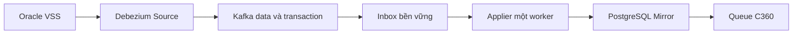

# Đề xuất CDC Sink và cutover Oracle → PostgreSQL Mirror

> Thiết kế đề xuất, chưa triển khai hoặc kiểm thử Sink/cutover. Chỉ tạo tài liệu này; không chạy SQL, sửa connector, đổi offsets hay thay Oracle/Kafka. Các kết quả vận hành dưới đây do người vận hành cung cấp. Cấu hình Source, SQL và tài liệu trong project đã được đọc để đối chiếu.

## 1. Điểm xuất phát và quyết định ưu tiên

- Recovery Candidate: `hdg_recovery_verified`, đối soát đủ bốn bảng với Oracle tại **SCN S = 2438031**.
- Run staging: `2ce4d328-976f-4a7f-9531-1fae4a22a34b`, snapshot staging được báo có 50.013 dòng. Khi lập manifest phải xác nhận count từng bảng từ table_runs, không gán 50.013 cho cả bốn bảng.
- Contract v2 và SHA256 stage audit đã PASS theo thông tin cung cấp. Chúng xác minh snapshot/staging/candidate, không xác minh CDC nối tiếp.
- Mirror live còn chuỗi bị cắt; không dùng nó làm baseline đúng.
- Source dùng `no_data`, `online_catalog`, bật metadata giao dịch và tombstone trong file cấu hình. Chưa có Sink.
- Topic dữ liệu hiện được báo có DANTOC, beginning=0, end=4. Đó là bốn record ở offsets 0..3 nếu không có khoảng trống; chưa biết chúng là c/u/d hay tombstone, không được gọi là bốn thay đổi nghiệp vụ.
- DANTOC/QUOC_TICH có PK ID. NHANKHAU/DBHC không có PK/UNIQUE; dữ liệu ID hiện tốt không phải ràng buộc lâu dài.

**Ưu tiên cho local:** dừng writer nguồn trong một cửa sổ kiểm soát, chốt baseline tại SCN R đã ổn định, chứng minh Source đã xử lý qua ranh giới đó, rồi khôi phục nội dung bốn Mirror và khởi tạo checkpoint Sink trong một transaction PostgreSQL. Chưa bật Sink ghi live trước khi qua các điều kiện ở mục 11.

Giữ candidate S nếu nó vẫn bằng nguồn tại R trên toàn bộ cột và số lần lặp. Nếu khác, tạo snapshot/candidate mới tại R, giữ candidate S làm bằng chứng. Không đưa candidate S vào live rồi bỏ toàn bộ Kafka hiện có mà chưa kiểm chứng khoảng S→R.

**Sink ưu tiên:** một consumer/applier riêng cho cả bốn bảng, có inbox bền vững, ledger chống lặp và transaction PostgreSQL. Hai bảng có PK dùng ID; hai bảng không PK dùng ngữ nghĩa tập có lặp và toàn bộ before-image, với điều kiện chặt ở mục 5. Đây là phương án cần thử nghiệm, chưa phải kết luận có thể chạy an toàn ngay.

Nếu không chứng minh được before-image, thứ tự hoặc định danh sự kiện khi replay, phải dừng triển khai CDC cho hai bảng không PK. Phương án dài hạn dễ vận hành hơn là thống nhất khóa kỹ thuật bất biến có ràng buộc Oracle; việc đó là thay đổi nguồn cần xử lý riêng, không thực hiện trong nhiệm vụ này.

## 2. SCN và Kafka offsets không phải cùng một loại mốc

SCN là vị trí/thời điểm nhất quán trong Oracle. Offset là vị trí record trong **một topic-partition** của Kafka. Không có phép tính chuyển SCN 2438031 thành offset 4, và không có một offset chung cho bốn bảng.

Ví dụ:

| Giao dịch | DML xảy ra | Commit | Có trong snapshot S? | Có cần áp sau snapshot S? |
|---|---:|---:|---|---|
| A | S−20 | S−10 | Có | Không áp lại |
| B | S−20 | S+10 | Không | Có, đủ mọi thay đổi của B |
| C | S+5 | S+20 | Không | Có |

Không lọc theo `source.scn > S` vì đó có thể là SCN của DML. B phải được xét theo commit, mặc dù DML đã xảy ra trước S. Để phát lại B từ redo cần đủ nhật ký từ phần cần thiết trước S, cùng lịch sử schema. `no_data` không tự chứng minh connector hiện tại có đủ lịch sử đó.

Đề xuất dùng `source.commit_scn` theo schema thực tế của event làm một thành phần phân loại baseline; không so SCN dưới dạng chuỗi từ điển, timestamp hay Kafka offset. Phân biệt trường trong event với cấu trúc offset nội bộ của Source: không tự parse/copy một chuỗi offset phức hợp vào SCN số.

Khi đã chứng minh baseline tại R:
- Commit ≤ R: trạng thái giao dịch đã được baseline bao phủ; không áp lại DML.
- Commit > R: chỉ áp khi thu đủ giao dịch và còn liên tục capture sau R.
- Không có/không giải mã được commit SCN: chặn giao dịch, không đoán từ thời gian nhận.
- Tombstone không có source metadata: xử lý theo loại record và checkpoint, không suy diễn thành một DELETE mới.

Tài liệu Oracle connector mô tả các trường nguồn và metadata giao dịch. Cách xử lý ranh giới, checkpoint và các điều kiện bên trên là đề xuất cho project. [Debezium Oracle 3.4](https://debezium.io/documentation/reference/3.4/connectors/oracle.html)

## 3. Cutover có dừng writer: quy trình có thể kiểm chứng

### 3.1. Lập cửa sổ bảo trì

1. Ngừng generator, ứng dụng, scheduler và mọi writer của bốn bảng VSS; ngừng DDL liên quan. Ngừng publisher/Full Load ghi live, job Queue/C360 và writer PostgreSQL khác.
2. Giữ Source chạy và giữ nguyên offset/history. Không khởi động Sink ghi live.
3. Chờ commit/rollback các giao dịch người dùng còn mở có thể tác động bốn bảng. Trong local nên yêu cầu không còn giao dịch writer người dùng chưa kết thúc, kể cả phiên chưa ghi VSS nhưng có thể ghi sau đó.
4. Kiểm chứng không còn phiên có thể tự ghi lại; quan sát SCN và transaction một lần không thay cho việc thực sự ngừng ứng dụng.
5. Chốt SCN R sau khi đã drain. Khi không chứng minh được giao dịch đã drain, dừng quy trình.

Ví dụ B ở mục 2 sẽ phải commit trước R hoặc rollback trước R. Nếu còn mở thì chưa được lấy R làm ranh giới bảo trì.

### 3.2. Chọn baseline

Đối soát candidate S với Oracle AS OF R bằng toàn dòng/multiset, đủ bốn bảng. Nếu bằng nhau, candidate vẫn dùng được về trạng thái tại R dù được tạo từ S; ghi riêng bằng chứng tương đương tại R, không sửa source_scn của run cũ thành R.

Nếu khác, dùng Spark stage-only tại R, tạo một candidate mới có tên riêng, đối soát lại và ghi audit. Không sửa candidate verified cũ hoặc chạy lại publisher legacy. Thời gian UNDO phải đủ cho bước đối soát.

Chỉ thay số dòng kỳ vọng khi có bằng chứng snapshot mới, không ép mọi baseline phải có 50.013 dòng.

### 3.3. Chứng minh Source đã qua ranh giới R

Không đủ nếu chỉ có RUNNING, topic end ổn định vài giây, consumer lag=0 hoặc một metric SCN lớn. Cần thu đồng thời:

- Bằng chứng nguồn đã ngừng ghi và không còn giao dịch nằm ngang ranh giới.
- Tiến độ mining đã xử lý hoàn chỉnh qua R, không chỉ cấu hình upper bound của truy vấn LogMiner.
- Không có giao dịch liên quan còn nằm trong bộ đệm, không có parse error/skipped event.
- Metadata END và đủ số sự kiện đã phát cho các giao dịch được capture đến ranh giới; không đếm tombstone như một DML.
- Hàng đợi phát sự kiện đã drain, producer đã hoàn tất ghi Kafka và Source offset đã được flush bền vững.
- Dữ liệu được đọc kiểm chứng từ Kafka và đối chiếu với snapshot/biến động đã biết.

Các metric như OffsetScn, CommittedScn, MiningSessionLowerBounds/UpperBounds là bằng chứng hỗ trợ, không tự tạo thành một giao thức barrier. Phải kiểm tra ngữ nghĩa metric/offset trên đúng phiên bản đang chạy. Không yêu cầu máy móc CommittedScn phải bằng R nếu nguồn không có commit được capture tại đó.

**Điểm chưa giải quyết:** project chưa có cơ chế barrier có bằng chứng hoàn chỉnh. Nếu trạng thái ít thay đổi làm không xác nhận được tiến độ, dừng tại đây. Có thể thiết kế marker/barrier được capture ở lần triển khai riêng, nhưng phải định nghĩa commit/ack, các topic được bao phủ và giao dịch đang mở; một marker ở DANTOC không tự chứng minh hoàn tất cả bốn topic. Không tự phát sinh marker DML hoặc thay connector trong lần rà soát này.

### 3.4. Chốt vector offsets B

Sau khi qua điều kiện drain, ghi vector `B[topic_id, topic, partition] = next_offset`, gồm bốn topic dữ liệu, transaction topic và các topic điều khiển thực sự dùng. End offset là mốc loại trừ: B=4 nghĩa record cuối của prefix là 3.

Thu vector khi nguồn vẫn dừng ghi; kiểm lại sau đó để phát hiện record đang đến muộn. Sự ổn định là kiểm tra bổ sung, không thay bằng chứng drain.

Với ba topic chưa tồn tại, ghi rõ ABSENT, không tự giả có partition 0/end 0. Sink phải có quy tắc khám phá topic allowlist: lần đầu xuất hiện đọc từ beginning, chốt topic UUID, kiểm retention không mất prefix. Nếu beginning đã lớn hơn 0 hoặc không xác minh được lịch sử tạo topic thì chặn, không nhảy latest.

Consumer group Sink mới được khởi tạo tại B theo manifest đã xác minh. Đây là khởi tạo một consumer mới, không reset Source offset hoặc offset group đang có. Không sử dụng auto.offset.reset=latest như một cách cutover.

Nếu Source restart rồi phát lại event cũ ở offset mới sau B, điều kiện commit ≤ R vẫn bao phủ chúng. Các event commit > R cần ledger theo định danh nguồn ở mục 7.

### 3.5. Nội dung manifest

Manifest dự kiến lưu: cutover epoch, trạng thái, DBID/PDB/resetlogs incarnation, cấu hình và phiên bản Source, S/R, run_id, tên candidate, schema contract/hash, count/digest từng bảng, bằng chứng tương đương S↔R nếu có, vector B với topic UUID, điều kiện drain, inventory dependency/trigger, backup và thời điểm phê duyệt chuyển live.

Một run_id/SCN/count đơn lẻ không thay được manifest. Trong transaction restore, ghi manifest ACTIVE và các checkpoint ban đầu cùng dữ liệu Mirror; lỗi ở bất kỳ bước nào thì rollback cả phần PostgreSQL.

## 4. Kiến trúc Sink đề xuất

Source phát envelope gốc. Consumer lưu record nguyên vẹn vào inbox. Applier ráp giao dịch, giải mã kiểu dữ liệu và chọn cách cập nhật theo từng bảng. Mirror và Queue được cập nhật trong transaction, rồi mới đánh dấu áp dụng xong.

Đề xuất local: một tiến trình Java 21 với Kafka Consumer và PostgreSQL JDBC, một applier ghi, heap khởi điểm 256–512 MiB có giới hạn container/process và theo dõi thực tế. Đây là lựa chọn kỹ thuật, không phải công nghệ bắt buộc. Không chạy đồng thời nhiều task ghi cùng hai bảng không PK. Applier giữ khóa advisory PostgreSQL trên connection ghi, kiểm cutover epoch trong mỗi transaction; connection thay mới phải lấy lại khóa. Restore phải lấy cùng khóa applier và các khóa Full Load/publish theo một thứ tự đã thống nhất. Consumer group không thay cho cơ chế ngăn hai writer ghi database.

Debezium JDBC Sink có thể phù hợp cho hai bảng PK với record_key/upsert/delete và schema.evolution=none. Tuy nhiên hai connector độc lập không tự bảo đảm transaction Oracle nhiều bảng được ghi nguyên khối ở PostgreSQL. Không chọn chúng làm giải pháp chung cho cả bốn bảng trong giai đoạn đầu. [Debezium JDBC Sink](https://debezium.io/documentation/reference/3.4/connectors/jdbc.html)

Không unwrap bỏ before/source/transaction trước khi hoàn thành thiết kế. Không lọc TYPEID, trạng thái duyệt, chuẩn hóa C360 hoặc suy ra “xóa người” trong Sink Mirror.

## 5. Khóa và thao tác trên từng bảng

| Bảng nguồn | Khóa có căn cứ | Cách áp dụng đề xuất |
|---|---|---|
| VSS_DM_DANTOC | PK ID | INSERT theo ID; UPDATE/DELETE theo old ID; kiểm before-state |
| VSS_DM_QUOC_TICH | PK ID | Như DANTOC; không dùng MA làm PK |
| VSS_HO_GD_NHANKHAU | Không có khóa vật lý | Tập dòng có lặp; match toàn bộ before-image, tác động đúng một bản sao |
| VSS_DM_DBHC | Không có khóa vật lý | Như NHANKHAU; toàn bộ cột có thể NULL |

### 5.1. Hai bảng có PK

- c: thêm after. Với ID đã có, chỉ coi là replay khi ledger chứng minh; trạng thái xung đột thì dừng, không upsert ghi đè vô điều kiện một event cũ.
- u: tìm old ID, kiểm giá trị trước phù hợp, cập nhật after đủ cột. Thiếu dòng hoặc before lệch thì chặn giao dịch.
- d: xóa đúng old ID. Thiếu dòng không tự coi là thành công nếu chưa chứng minh đã áp event.
- Đổi PK: hỗ trợ dạng d/tombstone/c theo envelope thực tế; ráp cùng giao dịch. Không coi old-key và new-key là hai người độc lập.
- Upsert được dùng như cơ chế ghi khi phù hợp, nhưng không thay ledger/order. Replay một UPDATE cũ sau UPDATE mới có thể làm lùi dữ liệu nếu chỉ upsert.
- ID NULL trong event của bảng có PK là lỗi decode/capture hoặc contract, không tự tạo ID.

### 5.2. Hai bảng không PK: ngữ nghĩa multiset

Mục tiêu Mirror là giữ đúng tập dòng và số lần lặp, không gán căn cước giả cho từng dòng nguồn.

- c: thêm đúng một after cho mỗi **sự kiện nguồn mới**. Hai INSERT khác nhau có payload giống hệt vẫn phải sinh hai dòng.
- u: tìm một dòng có toàn bộ giá trị bằng before, cập nhật **một** dòng đó thành after.
- d: tìm và xóa **một** dòng bằng toàn bộ before.
- So sánh NULL bằng IS NOT DISTINCT FROM; chuỗi theo collation C, giữ khoảng trắng; NUMBER và thời gian theo contract exact.
- Nếu có k dòng giống hệt before, chọn một bản sao chỉ trong transaction đó. UPDATE giảm một bản sao before, tăng một after; DELETE giảm một bản sao. Không UPDATE/DELETE toàn bộ k dòng.
- Nếu không tìm được before, rollback và báo lệch. Không suy ra event đã xử lý chỉ vì thấy after hoặc không thấy before.

Ví dụ DBHC có hai dòng giống hệt A. Một DELETE mới phải để lại một A; hai DELETE khác nhau phải hết A. Một DELETE phát lại phải không xóa thêm A. Ledger nguồn là điều kiện bắt buộc để phân biệt hai trường hợp sau cùng.

Có thể dùng PostgreSQL ctid để chọn/khóa một tuple trong **cùng statement/transaction**, dưới một applier độc quyền. Không lưu ctid vào checkpoint, không dùng nó làm row identity lâu dài; không chọn tuple ngoài transaction rồi dùng lại. Việc thực hiện cụ thể cần integration test. [PostgreSQL system columns](https://www.postgresql.org/docs/16/ddl-system-columns.html)

Điều kiện bắt buộc: before/after đủ cột, không placeholder “unavailable”, logging phù hợp, decoder không làm mất NULL/kiểu dữ liệu, một thứ tự áp dụng có thể kiểm chứng và ledger nguồn chống lặp. Supplemental logging đã bật không tự chứng minh đầy đủ before-image cho mọi UPDATE/DELETE. Phải kiểm tra event thật trên bộ test riêng.

Nếu before chỉ có vài cột, không được fallback sang ID/MA_CD hoặc UPDATE tất cả dòng khớp phần đó. Dừng, xử lý cấu hình capture trong một thay đổi được duyệt và thiết lập lại baseline nếu cần.

### 5.3. ID NULL, trùng hoặc thay đổi

Ở NHANKHAU/DBHC, ID hiện tốt chỉ dùng để chẩn đoán/tăng tốc tìm ứng viên, không là điều kiện quyết định duy nhất:

- NULL: vẫn có thể xử lý nếu full before-image hợp lệ và dữ liệu nguồn cho phép NULL.
- Trùng ID nhưng khác cột khác: phân biệt bằng toàn bộ before.
- Trùng hoàn toàn: giữ multiplicity, chỉ tác động một bản sao.
- UPDATE ID: áp old full-row → new full-row, không tự mất dòng cũ hoặc ghép hai dòng.
- UPDATE MA_CD/chuyển hộ: cập nhật đúng dòng hộ theo before, giữ các dòng hộ khác; Queue phải nhận cả old/new MA_CD nếu đổi mã.
- MA_CD NULL trong NHANKHAU: vi phạm contract NOT NULL, chặn thay vì tự sinh mã.
- Không tạo UNIQUE ID hoặc UNIQUE(MA_CD,MA_HO_GD) ở Mirror để “sửa” khó khăn của Sink.

ROWID Oracle và source.row_id không được mặc định làm khóa lâu dài; candidate hiện tại không chứa mapping ROWID đã kiểm chứng, và ROWID có thể đổi/tái sử dụng. Kafka coordinates cũng chỉ định danh record, không định danh dòng Oracle để UPDATE/DELETE. [Oracle ROWID](https://docs.oracle.com/en/database/oracle/oracle-database/26/sqlrf/ROWID-Pseudocolumn.html)

## 6. Envelope, tombstone và ordering

c/u/d là thay đổi dữ liệu; r là snapshot event. Vì Source đang no_data, gặp r ngoài một epoch bootstrap đã thiết kế thì chặn để đánh giá, không chèn trùng baseline. TRUNCATE hoặc DDL/schema drift không nằm trong đường xử lý c/u/d: dừng, không tự xóa Mirror.

Tombstone có Kafka value=null, không phải after=null trong envelope DELETE. Custom Sink dùng d để xóa, tombstone chỉ được ghi nhận/tiến checkpoint, không xóa lần hai. Với key-null không giả định có chuỗi tombstone giống bảng PK; phải xem record thực tế.

Kafka chỉ bảo đảm thứ tự theo partition. Đề xuất giữ một partition mỗi topic dữ liệu và transaction topic trong local; kiểm tra thực tế, không chỉ dựa default trong Compose. Không tăng partition khi đang chạy mà không thiết kế lại epoch/order.

Một partition mỗi bảng vẫn không tạo thứ tự chung giữa bốn topic. Applier cần:

1. Thu BEGIN/END và sự kiện từng giao dịch.
2. Kiểm số event/data_collection theo metadata END, accounting riêng cho tombstone và các record tổng hợp khi đổi key theo hành vi phiên bản thực tế.
3. Thu đủ và áp toàn bộ giao dịch trong một transaction PostgreSQL.
4. Tôn trọng FIFO của mỗi table-partition và thứ tự dữ liệu trong giao dịch; không vượt một giao dịch chưa hoàn chỉnh để áp giao dịch sau đang xung đột.
5. Kiểm chứng thứ tự commit do Source phát. Không chỉ sort danh sách đang có theo commit_scn rồi cho rằng không còn giao dịch đến muộn; không dùng txId từ điển làm thứ tự commit.
6. Nếu cần thứ tự toàn cục, phải có frontier/watermark chứng minh không còn giao dịch nhỏ hơn đang thiếu. Khi chưa có, chỉ được nhận phạm vi bảo đảm đã thử nghiệm; không tuyên bố snapshot nhất quán đa bảng liên tục.

Đề xuất chỉ bật khi đã chứng minh cách ráp/FIFO/metadata END đáp ứng thứ tự cần thiết cho bốn bảng trên một Source local. Thiếu END, event count không khớp hoặc xuất hiện vòng phụ thuộc thứ tự thì dừng applier và giữ inbox; không tự bỏ qua. Transaction metadata trong Kafka không có nghĩa PostgreSQL nhận được giao dịch nguyên khối sẵn.

## 7. Retry, replay và idempotency

Idempotent nghĩa là áp lại cùng sự kiện không đổi thêm trạng thái. Với bảng không PK, chỉ “xóa nếu có” hoặc “insert nếu chưa thấy payload” đều sai khi có dòng trùng.

### 7.1. Hai lớp nhận diện sự kiện

- Lớp vận chuyển: source cluster/topic UUID + partition + offset, UNIQUE trong inbox. Chặn xử lý lặp cùng Kafka record.
- Lớp nguồn: định danh redo ổn định qua Source restart, gồm database incarnation/PDB/table và các trường redo/transaction cần thiết. Phải nghiên cứu, kiểm chứng tổ hợp như txId, rs_id, ssn, redo_thread và discriminator c/u/d/old-key/new-key; không tuyên bố tổ hợp này đã là khóa duy nhất.
- Cùng source identity nhưng payload khác: báo xung đột và dừng. Hai sự kiện khác nhau có payload giống nhau: vẫn áp hai lần.
- Không dùng hash payload hoặc Kafka offset đơn lẻ làm khóa chống phát lại từ Source: Source có thể phát lại cùng redo vào offset mới.
- Chưa chứng minh được source identity ổn định/duy nhất thì chưa bật chiến lược multiset no-PK. Đây là rủi ro còn mở, không được che bằng upsert.

### 7.2. Inbox và hai checkpoint khác nhau

Consumer tắt auto commit. Lưu raw key/value/headers, topic UUID/partition/offset, decode metadata và trạng thái vào PostgreSQL. Chỉ ack Kafka sau khi bản raw đã commit bền vững; khi dùng inbox, ack này có nghĩa “đã lưu an toàn”, chưa có nghĩa “Mirror đã cập nhật”.

Applier commit nguyên tử: ledger sự kiện nguồn + thay đổi đủ bốn Mirror trong giao dịch + Queue trigger + trạng thái inbox + applied frontier. Kafka ack bị mất sau DB commit thì replay được nhận ra qua inbox/ledger. [Kafka consumer offsets và commit](https://kafka.apache.org/38/javadoc/org/apache/kafka/clients/consumer/KafkaConsumer.html)

Checkpoint “đã nhận” và “đã áp Mirror” phải tách biệt. Applied frontier chỉ qua prefix liên tục gồm APPLIED, BASELINE_COVERED hoặc tombstone đã xử lý; không nhảy qua record/giao dịch lỗi. Consumer lag=0 trong khi inbox còn pending vẫn là Mirror lag.

Ledger và checkpoint tách theo cutover epoch. Khi restore baseline mới không dùng lại ledger “đã áp” của trạng thái Mirror cũ để bỏ mất thay đổi, và không xóa ledger tùy tiện. Thời gian giữ ledger phải bao phủ khoảng replay/backup được hỗ trợ.

### 7.3. Lỗi và tài nguyên

Retry có giới hạn với mất kết nối, deadlock và timeout; rollback toàn transaction, không cập nhật applied frontier sớm. Lỗi schema, before mismatch, mất log, thiếu identity hoặc dữ liệu không vừa kiểu thì chặn. Có thể lưu quarantine để điều tra nhưng không skip/DLQ rồi báo Mirror đồng bộ đủ.

Giao dịch lớn giữ sự kiện ở inbox trên đĩa, không gom toàn bộ vào RAM không giới hạn. Không cắt transaction thành các commit Mirror tùy tiện, không bỏ transaction cũ để giảm bộ nhớ. Theo dõi archive retention, topic retention, inbox bytes/age, receive/applied lag và dung lượng PostgreSQL.

## 8. Bảng điều khiển dự kiến, chưa tạo DDL

| Bảng logic đề xuất | Nội dung |
|---|---|
| cdc_cutover_epoch | Baseline, R, candidate/run, manifest và trạng thái cutover |
| cdc_topic_checkpoint | Topic UUID, partition, next offset của receive/applied; phát hiện topic bị tạo lại |
| cdc_inbox | Raw record, metadata/schema, transaction, trạng thái và lỗi |
| cdc_source_event_ledger | Source identity, payload digest, epoch, kết quả áp dụng; UNIQUE đã kiểm chứng |
| cdc_transaction_state | END/event counts, số đã nhận, thứ tự, trạng thái transaction và lỗi |
| cdc_sync_log | Số received/applied/covered/retried, lag, thời gian và mã lỗi không lộ PII |

Không đặt các cột kỹ thuật này vào dữ liệu nghiệp vụ Mirror để giả tạo khóa nguồn. Tên cuối cùng cần thống nhất với schema vận hành, không sửa các bảng Sync/Queue thiết kế hiện có trong lần rà soát.

Decoder phải đọc schema logical types từ envelope: Decimal/VariableScaleDecimal giữ exact bằng số nguyên + scale, không qua float; phân biệt DATE, Timestamp/MicroTimestamp và múi giờ theo schema Source thực tế. Dùng cùng contract/guards chống cắt chuỗi và làm tròn đã sửa cho Full Load. Giá trị thiếu trường khác NULL; không thay giá trị unavailable bằng NULL.

## 9. Khôi phục Mirror và giữ dependency/trigger

### 9.1. Inventory bắt buộc

Trước triển khai, liệt kê OID, view/materialized view, FK vào/ra, index, owner/grant, RLS, trigger và function gắn từng Mirror, cùng các job/phiên đang dùng. File SQL hiện có không đủ để kết luận database thực tế chưa có trigger/dependency. Tài khoản bảo trì/đối soát phải nhìn đủ mọi dòng, không so qua role bị RLS che dữ liệu. Trigger có tác động ngoài database như gọi HTTP cần kế hoạch riêng vì rollback PostgreSQL không thu hồi được tác động đó.

Kiểm tra Mirror live đã có schema contract v2 đúng kiểu, không chỉ hàm version trả 2. Schema đúng không có nghĩa dữ liệu đã được phục hồi.

### 9.2. Transaction restore dự kiến

Trong khi nguồn và downstream vẫn dừng:

1. Backup dữ liệu lỗi, schema, control, Queue/C360 nếu có, và các checkpoint; giữ staging/candidate/Kafka.
2. Lấy các khóa vận hành chung với Full Load/Sink và khóa đủ bốn Mirror, kiểm tra lại candidate/manifest không đổi.
3. Thay **nội dung** bảng hiện có bằng baseline tại R. Không DROP/rename/swap bảng để tránh đổi OID hoặc để view/FK/trigger trỏ sang bảng cũ.
4. Với bảng không PK có thể dùng DELETE rồi INSERT theo cột tường minh trong transaction, sau khi inventory cho phép. Với bảng PK có FK tham chiếu, ưu tiên cập nhật ID còn tồn tại/thêm ID mới; xóa ID đã mất chỉ khi quan hệ tham chiếu đã được xử lý hợp lệ. Không giả định có thể DELETE toàn bộ rồi INSERT lại khi FK immediate còn hoạt động.
5. Giữ constraint/index/owner/grants. Không dùng CASCADE hoặc session_replication_role=replica để vượt rào chắn.
6. So toàn dòng hai chiều candidate↔Mirror, count/multiplicity, typed values, và kiểm checkpoint/baseline. Lệch một bảng thì rollback.
7. Ghi cutover epoch ACTIVE và applied checkpoint baseline B trong cùng transaction với restore. Không sửa lịch sử run cũ/NOOP để che lỗi; cờ cdc_enabled chỉ thay tại bước chuyển đã thiết kế, không dùng để vượt preflight.
8. Commit; kiểm lại khi writer còn dừng. Nếu lỗi sau commit, giữ bảo trì và dùng quy trình khôi phục theo epoch, không reset Source hoặc chạy publisher bootstrap.

Đây là đặc tả, chưa có SQL restore để chạy trực tiếp vì inventory/trigger/barrier chưa có bằng chứng.

### 9.3. Queue và downstream

Không bật job C360 trong lúc restore. Nếu giữ trigger, đánh giá số lượng Queue phát sinh, nhưng Queue và dữ liệu phải cùng transaction. Nếu cần giảm enqueue, chỉ đề xuất tạm ngừng đúng trigger ứng dụng đã kiểm kê rồi enqueue lại có kiểm soát; không DISABLE TRIGGER ALL và không vô hiệu hóa FK.

Phải bao phủ MA_CD từ Mirror cũ, baseline mới và C360 hiện có nếu đã có dữ liệu; chỉ lấy mã mới sẽ để lại công dân mồ côi. Ưu tiên rebuild C360 nhất quán tại baseline khi dữ liệu downstream chưa đáng tin. Đánh dấu epoch Queue; không xóa hàng đợi theo ID <= MAX(ID), không ACK thay đổi CDC đến sau baseline.

Trong vận hành CDC, trigger nhận cả old/new MA_CD khi đổi mã. Thay đổi danh mục có thể ảnh hưởng nhiều công dân: cần refresh Map và enqueue tập phụ thuộc hoặc rebuild phù hợp, không chỉ xem sự kiện nhân khẩu.

## 10. Bộ kiểm thử end-to-end đề xuất

Chỉ chạy ở môi trường test/maintenance được phép, chưa thực hiện trong lần rà soát.

| Nhóm | Kịch bản | Điều kiện đạt và bằng chứng |
|---|---|---|
| Baseline | Candidate đúng tại S nhưng nguồn đổi trước R | Không chuyển live bằng S nếu thiếu bằng chứng; đối soát R hoặc tạo candidate mới |
| Transaction ngang SCN | DML trước S, commit sau S; rollback; giao dịch chưa đóng khi freeze | Commit sau S được áp đủ khi replay S; rollback không áp; không chốt R khi còn writer transaction |
| Barrier | RUNNING nhưng Source lag; topic yên lặng; END đến trước data topic | Không tuyên bố drain/cutover sớm, có manifest chứng minh qua R |
| Offset | Beginning 0/end 4 có tombstone; ba topic chưa có; topic xuất hiện sau cutover | Không đếm record thành số DML; không bỏ record đầu; lưu UUID/next offset đúng |
| PK | c/u/d ở hai danh mục; đổi ID; event cũ sau event mới | Đúng đủ 6/3 cột; không còn old PK; không hồi sinh/ghi lùi do replay |
| Không PK | ID NULL/trùng/đổi; MA_HO_GD NULL; một MA_CD nhiều hộ | Giữ đúng dòng hộ và toàn bộ 111/12 cột; không ép UNIQUE giả |
| Multiset | Hai dòng giống hệt, một UPDATE/DELETE; hai INSERT giống nhau | Tác động đúng một bản sao mỗi source event, giữ đúng multiplicity |
| Before-image | Thiếu cột, unavailable, before không khớp | Rollback, quarantine, applied frontier không qua lỗi; không fallback ID |
| Replay consumer | Crash trước commit DB; sau commit trước ack | Không mất thay đổi, không nhân dòng/xóa hai lần; Queue không phát lại do replay đã nhận diện |
| Replay Source | Restart phát cùng redo sang offset mới | Ledger nguồn nhận ra; hai event khác nhau cùng payload vẫn áp đủ |
| Ordering | Nhiều UPDATE cùng dòng; transaction đổi cả bốn bảng; key change | Không đọc trạng thái nửa transaction, không áp giao dịch vượt frontier chưa hoàn chỉnh |
| Tombstone | DELETE rồi tombstone; key-null; tombstone đến lại | Chỉ DELETE nghiệp vụ một lần; checkpoint tiến đúng |
| Kiểu dữ liệu | ID 17 ký tự, Unicode/BYTE, CCCD có 0 đầu, NUMBER lớn/scale, DATE/TIMESTAMP | Không cắt/làm tròn/đổi giờ; schema và multiset/hash đối soát phù hợp |
| Restore | View/FK/grant/trigger/RLS; lỗi ở bảng cuối | OID và dependency giữ nguyên; rollback cả bốn bảng khi lỗi; Queue đúng tập mã |
| Retention/lỗi | Kafka/PG mất kết nối, restart giữa transaction, mất history/log hoặc topic UUID đổi | Không auto reset/latest/skip; bảo toàn inbox/checkpoint và chặn khi không đủ bằng chứng |
| Nghiệp vụ | TYPEID/duyệt bị loại, đổi MA_CD, chuyển hộ, xóa hộ mới nhất | Mirror vẫn nguyên trạng; Queue có old/new; C360 xử lý theo quy tắc riêng |

Mỗi ca cần lưu: input/transaction test, SCN start/commit, raw key/value/headers và schema, topic UUID/partition/offset, END metadata, ledger/receive/applied checkpoint, before/after bốn Mirror và kết quả đối soát cùng checkpoint. Dữ liệu minh họa phải giả lập, log chia sẻ cần che PII/mật khẩu.

Đối soát cuối không chỉ COUNT: đầy đủ cột, NULL, multiplicity và kiểu số/thời gian. SHA256 của staging/candidate là một bằng chứng baseline; không dùng nó thay kiểm capture/update/delete.

## 11. Các điều kiện phải đạt trước khi bật Sink live

1. Candidate cuối tương đương Oracle tại R; đủ bốn bảng, count/digest và so nội dung toàn dòng; không chỉ PASS tại S cũ.
2. Nguồn đã freeze/drain, Source có bằng chứng bao phủ ranh giới và vector B đúng; xử lý được topic chưa tồn tại. Không còn khoảng trống chưa giải thích.
3. Xác nhận actual envelope/key, before/after, schema logical types và metadata giao dịch của cả bốn bảng; hiện một topic DANTOC chưa đủ bằng chứng.
4. Chiến lược full-row multiset vượt qua test NULL/trùng/key change, ordering và replay Source ở offset mới. Nếu không đạt, chưa bật CDC hai bảng không PK.
5. Restore qua được test dependency/trigger, atomicity và rollback; có backup, manifest/checkpoint chung transaction.
6. Sink/applier vượt qua test mất kết nối/crash; applied lag đo riêng với receive lag; đủ retention và tài nguyên.
7. Sau restore trong cửa sổ vẫn freeze, đối soát live với baseline; chỉ mở writer sau khi Sink đã được khởi tạo đúng B và cơ chế nhận thay đổi tiếp theo sẵn sàng.
8. Chạy các biến động E2E có kiểm soát sau khi được phép mở lại, drain tại checkpoint mới và đối soát tiếp. Chưa có bằng chứng này thì không ghi CDC E2E PASS.

## 12. Các điểm còn mở và trình tự triển khai

Các rủi ro chưa giải quyết: barrier Source→Kafka có bằng chứng, full before-image không PK, source-event identity ổn định qua replay, thứ tự transaction đa topic, inventory dependency thực tế, trạng thái nguồn hiện tại so với S, retention và dung lượng inbox. Không có dữ kiện để tự chốt chúng đã đạt.

Trình tự ưu tiên:
1. Chỉ đọc inventory, raw event/schema, Source progress/offset và Kafka metadata; lập checklist bằng chứng cho barrier/keys.
2. Dựng Sink và ledger trên database/schema test, kiểm cả bốn bảng; không thử bằng cách ghi Mirror lỗi hiện tại.
3. Chốt phương án no-PK sau test. Nếu không đạt, thiết kế khóa kỹ thuật nguồn riêng hoặc giữ chế độ snapshot có bảo trì; không gọi snapshot refresh là CDC liên tục.
4. Lập kế hoạch freeze, baseline R và backup; xác minh candidate S có thể tái sử dụng hay phải tạo mới.
5. Thực hiện restore/checkpoint theo transaction đã review; khởi tạo consumer mới, không reset Source.
6. Đối soát khi vẫn freeze, rồi mới mở writer có kiểm soát và chạy nghiệm thu E2E.
7. Chỉ sau nghiệm thu mới cho chạy C360/BI/API theo checkpoint phù hợp.

Không triển khai ngay generic JDBC Sink cho bốn bảng bằng ID, không dùng Kafka offsets làm PK dòng nghiệp vụ, và không coi offset DANTOC=4 là “SCN cutover đã an toàn”.
